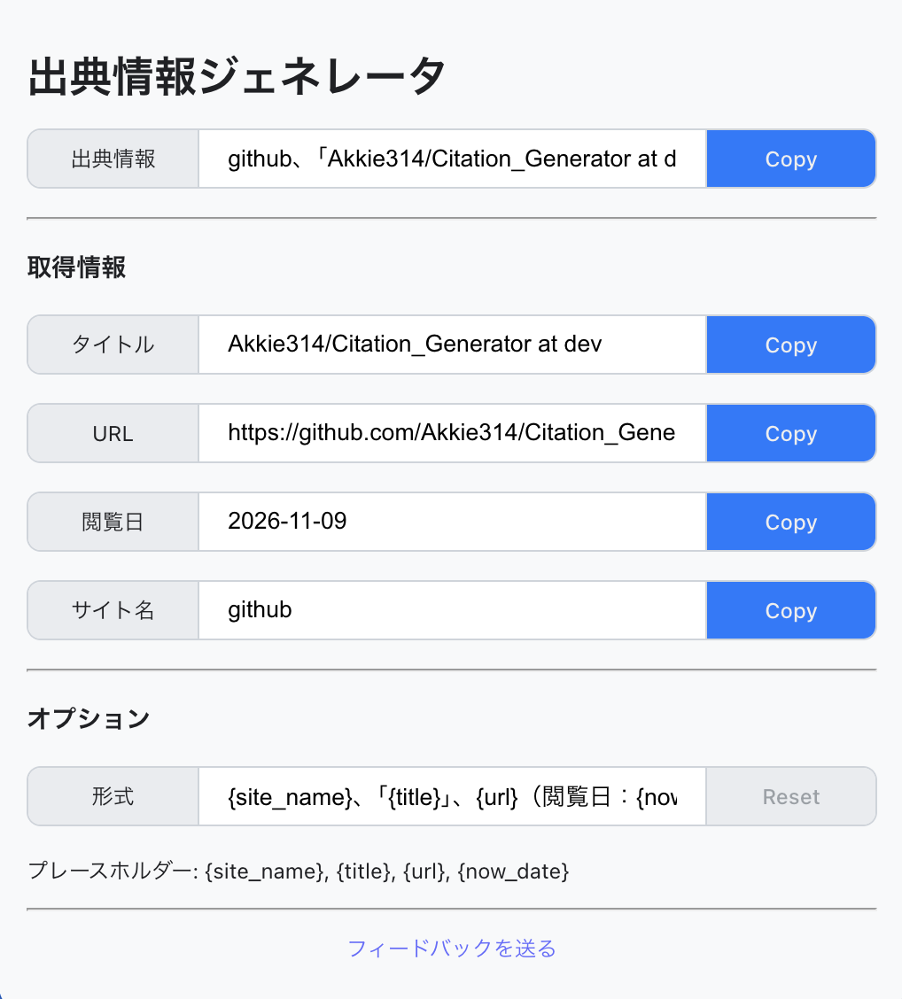

# Citation Generator
Citation Generatorは、Webページの出典情報を簡単に作成するためのChrome拡張機能です。ワンクリックで出典情報を作成できるため、論文やレポートの作成がこれまで以上にスムーズになります。

`

## 主な機能
- 閲覧中のページの情報(タイトル、URL、サイト名、閲覧日)を取得できます。
- 取得した情報をもとに出典情報を生成できます。
- 出典情報の形式をユーザーがカスタマイズできます。
- 出典情報や、タイトルやURLなどのページ情報をワンクリックでコピーできます

## インストール方法
- **オプション1(おすすめ)** - [ChromeWebStore](https://chromewebstore.google.com/detail/gaambbnjoocmcbomgfgipgjiioapiblf?utm_source=item-share-cb)からインストール
- **オプション2** - githubから手動でインストール(開発者向けをみてください。)

## 使い方
1. 出典情報を取得したいページを開きます。
2. ブラウザのツールバーにある、この拡張機能のアイコンをクリックします。
3. 表示されるポップアップに情報が表示されます。
4. 必要に応じて、各情報の横にあるコピーボタンを押すことでワンクリックでコピーできます。


## 開発者向け
この拡張機能は [WXT](https://wxt.dev/) + Vue 3 + TypeScript で作られています。開発にはNode.jsとnpmが必要です。

### 構成
- `entrypoints/` - 拡張機能のエントリーポイント(`background.ts`、`popup/`)
- `components/` - ポップアップで使うVueコンポーネント
- `composables/` - Vueのコンポーザブル
- `utils/` - ページ情報の取得、サイト名の推測、出典情報の整形、設定の保存などのロジック
- `wxt.config.ts` - WXTとマニフェストの設定
- `web/` - チェンジログ表示用のWebページ(Vite + Vue。拡張機能本体とは別のプロジェクトです)

### 開発環境のセットアップ
1. このレポジトリをクローンする
2. 依存パッケージをインストールする(`wxt prepare`も自動で実行されます)
   ```bash
   npm install
   ```
3. 開発サーバーを起動する
   ```bash
   npm run dev
   ```
   Chromeが自動で開き、拡張機能が読み込まれます。コードを修正すると自動でリロードされます。

### 主なコマンド
| コマンド | 内容 |
| --- | --- |
| `npm run dev` | 開発サーバーを起動(Chrome) |
| `npm run dev:firefox` | 開発サーバーを起動(Firefox) |
| `npm run build` | 本番用にビルド(`.output/chrome-mv3`) |
| `npm run build:firefox` | Firefox向けにビルド |
| `npm run zip` | 公開用のzipを作成 |
| `npm run zip:firefox` | Firefox向けのzipを作成 |
| `npm run compile` | 型チェック(`vue-tsc --noEmit`) |

### ビルドした拡張機能を手動で読み込む
1. `npm run build` を実行します。
2. Chromeブラウザで [chrome://extensions](chrome://extensions) を開きます。
3. 右上の「デベロッパーモード」をONにします。
4. 「パッケージ化されていない拡張機能を読み込む」をクリックして、`.output/chrome-mv3` フォルダを選択します。
コードを修正した場合は、再度ビルドしたうえで [chrome://extensions](chrome://extensions) からこの拡張機能の横にあるリロードボ
タンを押してください。

### チェンジログページ(`web/`)
```bash
cd web
npm install
npm run dev
```

## 工夫した点
### サイト名の高精度な自動推測機能
私が最初にインストールした類似した出典情報作成拡張機能では、Webサイトのog:site_nameに依存しています。ただこれが設定されていない一部のサイトではサイト名が「取得できませんでした」となってしまうことが課題でした。\
\
本拡張機能ではサイト名が取得できなかった場合でも、URLのドメイン名からサイト名を推測する機能を実装しています。\
\
### 推測ロジック
この機能は、まずページのホスト名（例: www.github.com や www.kyoto-su.ac.jp）を取得します。次に、ドメインをピリオド (.) で区切り、以下のルールでサイト名を推測します。

1. 一般的なドメインの場合\
`www.github.com` → 末尾から2番目の `github` をサイト名として取得します。

2. 属性型ドメイン（.ac.jp や .co.jp など）の場合
`www.kyoto-su.ac.jp` → 末尾から2番目が `ac` や `co` などの属性型ドメインの場合、代わりに末尾から3番目の `kyoto-su` をサイト名として取得します。

このロジックにより、og:site_name が設定されていない多くのWebサイトでも、適切なサイト名を自動で補完できます。

## ライセンス
このプロジェクトはMITライセンスのもとで公開されています。詳細は[LICENSE.md](LICENSE.md)をご覧ください。