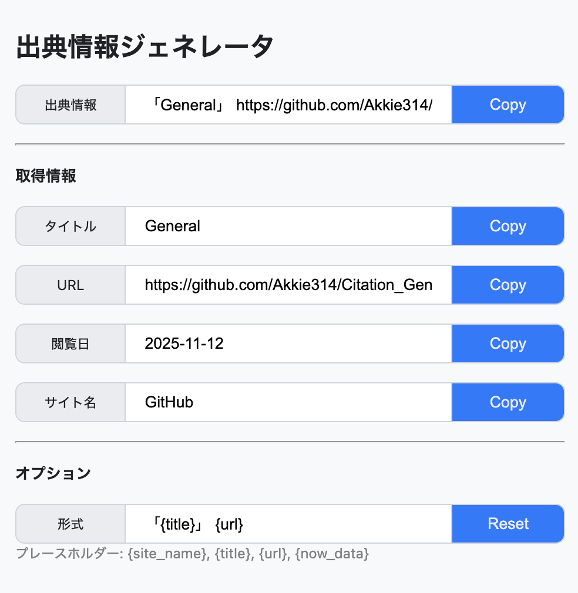

# Citation Generator
Citation Generatorは、Webページの出典情報を簡単に作成するためのChrome拡張機能です。ワンクリックで出典情報を作成できるため、論文やレポートの作成がこれまで以上にスムーズになります。

`

## 主な機能
- 閲覧中のページの情報(タイトル、URL、サイト名、閲覧日)を取得できます。
- 取得した情報をもとに出典情報を生成できます。
- 出典情報の形式をユーザーがカスタマイズできます。
- 出典情報や、タイトルやURLなどのページ情報をワンクリックでコピーできます

## インストール方法
- **オプション1(おすすめ)** - [ChromeWebStore](https://chromewebstore.google.com/)からインストール(離リンクは仮置き)
- **オプション2** - githubから手動でインストール(開発者向けをみてください。)

## 使い方
1. 出典情報を取得したいページを開きます。
2. ブラウザのツールバーにある、この拡張機能のアイコンをクリックします。
3. 表示されるポップアップに情報が表示されます。
4. 必要に応じて、各情報の横にあるコピーボタンを押すとワンクリックでコピーできます。

## 開発者向け
この拡張機能はNode.jsのような特別なビルドプロセスを必要としません。インストールは以下の方法で可能です。
1. このレポジトリをクローンする
2. Chromeブラウザで [chrome://extensions](chrome://extensions)を開きます。
3. 右上の「デベロッパーモード」をONにします。
4. 「パッケージ化されていない拡張機能を読み込む」をクリックして、クローンしたフォルダを選択します。

またコードを修正した場合は、[chrome://extensions](chrome://extensions) からこの拡張機能の横にあるリロードボタンを押すとで変更を適用できます

## 工夫した点

## ライセンス
このプロジェクトはMITライセンスのもとで公開されています。詳細は[LICENSE.md](LICENSE.md)をご覧ください。